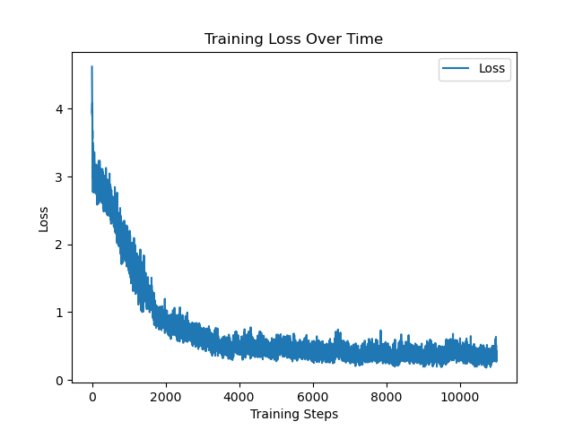

# SugarZero

An AlphaZero-style reinforcement learning agent for *Sugar*, a small abstract strategy game I invented. It learns only from self-play, with Monte Carlo Tree Search guided by policy and value networks, and no human knowledge or heuristics.

I built it to understand how AlphaZero actually works by implementing a version that trains on a laptop. The most useful part turned out to be the training plateau and figuring out why it happened (see [Results](#results)).


## The game

Sugar is played on a 3x3 board. I first played it with sugar packets at restaurant tables, hence the name.

- Each player has 6 stackable pieces, starting on their back rank.
- On each turn, a player moves the top piece of one of their stacks to an adjacent square (horizontally, vertically or diagonally).
- A piece can only move onto a stack that is no taller than the stack it leaves.
- In the first three moves, each player must make at least one forward move.
- A player with no legal moves loses.

## How it works

- **Search.** MCTS with PUCT (c_puct = 1.4), as in AlphaZero. Dirichlet noise (alpha = 0.8, weight 0.1) on the root priors for exploration, and temperature sampling (T = 0.7) for the first 3 moves of each self-play game, then greedy play.
- **Networks.** Separate policy and value networks in PyTorch, each with 3 convolutional layers (64 channels, batch norm) over a 12-channel board encoding. The policy network outputs a distribution over 81 moves and is trained with KL divergence against the MCTS visit distribution; the value network predicts the game outcome with MSE.
- **Training data.** A replay buffer mixing 70% self-play games, 20% games from plain UCT search and 10% random games. The networks are first trained on 400 UCT warmup games before self-play takes over. Games with no winner after 200 moves count as draws and are discarded, so the agent doesn't learn from cycles.
- **Parallelism.** Self-play games run in parallel in a process pool.
- **Tests.** Unit and integration tests for the game rules, MCTS, networks, replay buffer and training loop in `tests/`.

## Results

After 10,000 self-play games, the latest network wins about 48% of games against older checkpoints, and the rest are draws. The loss plateaued early, and a human can still beat the agent fairly easily.



**Why it plateaued.** Sugar never removes pieces from the board, so nothing pushes a game toward an ending. In chess or Go, captures and territory steadily simplify the position. In Sugar, the cheapest way to not lose is to stall and repeat positions. The agent learned to avoid losing rather than to win, and self-play against an equally cautious opponent gave it few decisive games to learn from.

What I would try next: rules that break cycles (repetition counts as a loss, or a move limit with a scoring rule), reward shaping for progress toward the opponent's side, and a training mix that weights decisive games more heavily.

## Getting started

```bash
git clone https://github.com/MarcosSaade/SugarZero.git
cd SugarZero
pip install torch numpy pygame matplotlib
python main.py          # play against the trained agent (checkpoint at game 10,000)
```

Controls: **R** restart, **Q** quit, **A** toggle the AI, **S** swap the AI's side, **D** cycle difficulty (easy, medium, hard).

Training from scratch, or resuming:

```bash
python train.py --workers 8
python train.py --resume --policy-path checkpoints/policy_model_4000.pt \
                --value-path checkpoints/value_model_4000.pt --start-game 4001
python eval_checkpoints.py     # play checkpoints against each other
```

## Project structure

| File | Contents |
|---|---|
| `game_state.py` | Board representation and rules |
| `mcts.py` | PUCT search, with and without returning the visit distribution |
| `policy_net.py`, `value_net.py` | The two networks |
| `replay_buffer.py` | Mixed replay buffer |
| `train.py` | Warmup, parallel self-play and training loop |
| `eval_checkpoints.py` | Checkpoint-vs-checkpoint evaluation |
| `game.py`, `main.py` | Pygame interface for playing against the agent |
| `constants.py` | Search, exploration and UI constants |
| `checkpoints/` | Trained models and training curves |

More on the project: [marcossaade.github.io/sugarzero](https://marcossaade.github.io/sugarzero)
