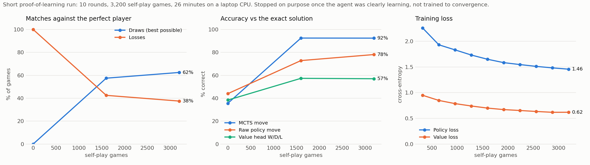

# SugarZero

An AlphaZero reimplementation for *Sugar*, a small board game I invented with friends, checked against
an exact solution of the game.

Sugar has 86.8 million reachable positions, few enough to solve completely with retrograde analysis.
That gives something most self-play projects lack: ground truth. Every move the agent makes can be
scored as right or wrong, and the agent can be played against a perfect opponent. The solver is used
only for evaluation. The agent learns from self-play alone, starting from the rules.



| Agent | Games vs perfect player (W / D / L) | Best move found (critical positions) |
|---|---|---|
| Untrained network + MCTS | 0 / 0 / 40 | 36% |
| Before the bug fixes below, 10,000 self-play games | 0 / 0 / 24 | not measured; about 20% of moves lose the draw |
| Fixed pipeline, 1,600 self-play games | 0 / 23 / 17 | 92% |
| Fixed pipeline, 3,200 self-play games (26 min on a laptop CPU) | 0 / 25 / 15 | 92% |

The starting position is a theoretical draw, so a draw is the best possible result against the
perfect player. The current agent plays a losing move only 0.6% of the time in those matches. Each
one costs the game, because the perfect player never lets a mistake go.

This was a deliberately short run: 10 rounds of 320 self-play games, enough to show that the fixed
pipeline learns, then stopped. The curves are still moving when it ends: the policy loss is still
falling, and draws against the perfect player and raw-policy accuracy are still rising. Search
accuracy reached 92% early, and the value head (57% correct) is the clearest place left to improve.
With an exact solution already known, training to convergence would only confirm a number the
solver gives directly.

## The game

Sugar is played on a 3x3 board. Each player starts with 6 pieces stacked two high on their back row.

- On your turn, move the top piece of one of your stacks to an orthogonally adjacent square.
- The destination stack must be no taller than the stack you move from, and stacks hold at most 6 pieces.
- Each player must make at least one forward move within their first three moves.
- A player with no legal move loses. Games reaching 200 plies (single moves by either player) are
  scored as draws.

Blue moves first. I originally played it with sugar packets on restaurant tables, hence the name.


## Solving the game

`solver/solve.c` enumerates every position reachable from the start, then runs retrograde analysis:
positions with no legal move are losses, a position is won if some move reaches a lost position, and
lost if every move reaches a won one. Positions never resolved this way are draws, because neither
side can force a result. It takes about 80 seconds and 3.5 GB of RAM on a laptop. The opening
forward-move rule only affects the first few moves, so `oracle.py` handles it with a small search on
top of the table.

What the solution says:

- **The start is a draw.** Of Blue's seven possible first moves, the three forward moves all lose
  (7 to 4 loses in 20 plies, the other two in 36). Only the sideways moves keep the draw.
- **Position values:** 42.8% of positions are wins for the side to move, 28.4% losses, 28.8% draws.
- **Longest forced win:** 127 plies.

## Bugs the solver caught

Before these fixes, training plateaued after 10,000 games and the agent lost every game against the
perfect player. Without ground truth, that looked like a property of the game: pieces are never
captured, so nothing forces games toward a result. Scoring moves against the solver pointed to bugs
in the training code instead:

- **MCTS backup sign error.** Values were credited to the wrong player at every other depth, so
  half the search was optimising for the opponent.
- **Terminal positions were scored by the value network** instead of by the actual result.
- **Drawn games were discarded.** With good play the game is a draw, so the network only ever
  learned from games where someone blundered.
- **Winners were duplicated in the replay buffer,** which pushed every value estimate upward.
- **An off-by-one in the opening rule** gave Blue four moves to make its forward move instead of three.

## How it works

- `sugar.py`: the rules on a 64-bit integer encoding (9 stacks x 7 bits plus the side to move).
- `network.py`: a residual CNN (4 blocks, 64 channels, 0.3M parameters). The board is always shown
  from the side to move's point of view. It has a policy head over 36 actions (from-square x
  direction) and a win/draw/loss value head.
- `mcts.py`: PUCT search with negamax backup, exact terminal values, first-play urgency, and root
  Dirichlet noise. Many games are searched together so the network evaluates leaves in batches.
- `train.py`: parallel self-play workers. Draws are kept as training targets, positions are
  augmented with their left-right mirror, and a quarter of games start after a short random
  opening for variety.
- `evaluate.py`: scores the network against the exact solution, using positions where the choice of
  move changes the result, and plays matches against the perfect player.

## Usage

```bash
pip install -r requirements.txt

# Play against the trained agent (D cycles Easy / Medium / Hard / Perfect)
python main.py

# Solve the game (needed for evaluation, Perfect mode and tests/test_oracle.py)
gcc -O2 -o solver/solve solver/solve.c && ./solver/solve solver/solution.bin
python evaluate.py --build                        # oracle-labelled test set
python evaluate.py --ckpt models/sugarzero.pt     # accuracy + matches vs perfect play

# Train from scratch and plot the curves
python train.py --out runs/run1
python plot_training.py runs/run1/log.jsonl

pytest tests
```

UI controls: R restart, Q quit, A toggle AI, S swap AI side, D cycle difficulty.

The run behind the figure is recorded in `docs/training_log.jsonl` and `docs/training_config.json`,
and the evaluated network is `models/sugarzero.pt`.
